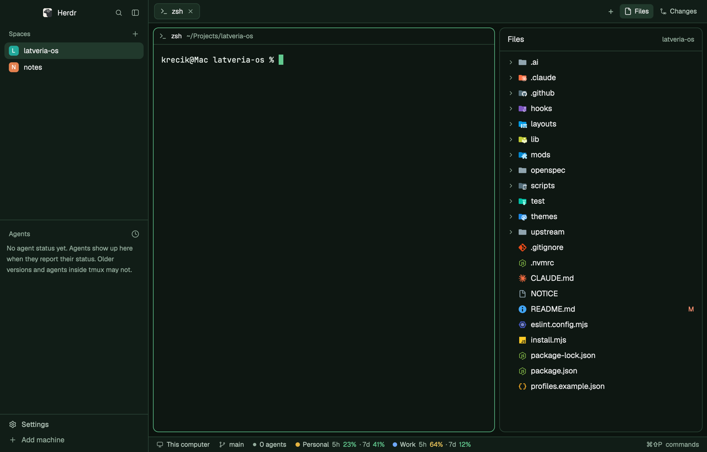

# LatveriaOS

A readable, dark-green layout and mods for [Herdr app](https://herdr.dev): every agent shows its
Claude profile and machine, the Files panel gets colored file-type icons, and the status bar
shows 5h/7d usage limits per profile across machines.



*Independent fan tribute, not affiliated with Marvel.*

## Status

| Milestone | What you get | State |
|---|---|---|
| M0 | `latveria` theme (every text/background pair ≥ 4.5:1) and `latveria` layout | done |
| M1 | Files panel with Material Icon Theme file-type icons, larger text | done |
| M2 | Agents list with profile badge and machine, larger text | done |
| M3 | 5h/7d usage limits per profile, from every machine, in the status bar | done |
| Waiting agents | Dock badge, clickable "needs you", macOS banners while Herdr is not in front | done |

Panel text sizes live in each mod's code, not in the layout, so M0 changes colors only; the
spaces list and tabs keep Herdr's sizes until their own mods are cloned.

## Files panel

The `latveria-files` mod replaces Herdr's Files panel. Every row gets a full-color Material Icon
Theme icon at 16 px; file names are 14 px and secondary text is at least 12 px. An icon is
picked the way VS Code does it: the full file name first, then the longest extension
(`test.mjs` before `mjs`), then the plain extension, then the default file icon. Folders have a closed
and an open icon. On a remote machine the panel lists, reads and checks git status there too; it
refreshes every 10 s, since folder watching only works locally (as in Herdr's own panel).

## Agents list

The `latveria-agents` mod replaces Herdr's Agents list. Under each agent's name (14 px) a second line (12 px)
says as whom and where it runs: a dot in the Claude profile's color, the profile's label and the machine
(`Mac` for this computer, the machine's name for a remote one). An agent without a profile shows `?`. The
selected row gets no status tint, so its badge keeps its contrast. On the narrow rail the same text is a tooltip.

The profile comes from a Claude Code `SessionStart` hook that labels the Herdr terminal
`latveria.profile=<KEY>`. Each machine describes its profiles in `~/.config/latveria/profiles.json` (copy
`profiles.example.json`; it stays out of the repo):

```json
{ "profiles": [
  { "key": "Personal", "label": "Personal", "claudeDir": "~/.claude", "color": "#e3b341" },
  { "key": "Work", "label": "Work", "claudeDir": "~/.claude-work", "color": "#6ea8fe" } ] }
```

The profile whose `claudeDir` is the session's `CLAUDE_CONFIG_DIR` (default `~/.claude`) wins. The hook
needs `jq` (macOS ships it in `/usr/bin`), runs `hc label` (from `PATH`, else `~/.local/bin/hc`) and nothing else, prints nothing and always exits 0.
Register it once per Claude config in `settings.json` (the installer does not edit Claude's settings):

```json
{ "hooks": { "SessionStart": [ { "hooks": [
  { "type": "command", "command": "sh \"$HOME/.config/latveria/hooks/latveria-label.sh\"" } ] } ] } }
```

Sessions started before that show `?` until they restart or resume. Agents on a remote machine get their
profile from that machine's own hook and map; the list reads each ready machine's map there. A session over
SSH may have a locked Keychain (`Not logged in`); that is Claude's login, not this hook.

## Status bar

The `latveria-status` mod replaces Herdr's status bar (12 px text) and adds, per Claude profile, `● Personal 5h 3% ·
7d 4%`: the profile's dot and label and the share of its 5-hour and 7-day limits used, green below 50 %, yellow below
80 %, red from 80 %. The tooltip says on which machine, when each window resets and when the numbers last changed. A
profile used on two machines shows the newer window. A machine that stops answering (a sleeping laptop) keeps its last
numbers, dimmed, with their age (`· 2h ago`). Without any snapshot the bar shows `limits ?`.

The numbers come only from the JSON Claude Code passes to its statusline: no Keychain, no network. Add one line to your
statusline script, right after it reads stdin into `input`:

```bash
q="$HOME/.config/latveria/hooks/latveria-quota.sh"
[ -r "$q" ] && { printf '%s' "$input" | sh "$q" >/dev/null 2>&1 & }
```

`latveria-quota.sh` finds the profile the same way the label hook does and keeps `~/.cache/latveria/quota-<KEY>.json`
(key, label, color, both windows). It writes only when those change, through a temp file and `mv`, prints nothing and
always exits 0. The bar reads every machine's snapshots there every 30 s, and a machine that becomes ready within about
5 s. A failed `mv` can leave a hidden `.quota-*` temp file in that folder; the bar ignores it.

## Waiting agents

Herdr plays a sound and draws a note in its own window when an agent needs you, or finishes while you aren't looking.
In another app you hear the sound and see nothing. The `latveria` layout adds:

- **Dock badge**: the number of agents that need you, on this computer and every machine, on Herdr's Dock icon.
- **Clickable counter**: `· 2 needs you` in the status bar shows the agent that has waited longest.
- **macOS banners**: while Herdr's window is not in front, every note Herdr posts becomes a banner under the clock
  (the `latveria-toast` mod hands it to the status bar, which waits for the click). Clicking it brings Herdr forward
  on that agent; closing or swiping it away changes nothing. While Herdr is in front, notes look as before.

Banners need [`terminal-notifier`](https://github.com/julienXX/terminal-notifier) (MIT), which the installer does not
install:

```sh
brew install terminal-notifier
terminal-notifier -diagnose   # "authorization: authorized" once allowed
```

The first banner asks macOS for permission; if you miss the prompt, allow it in System Settings › Notifications ›
terminal-notifier, style **Banners**. Without the program or the permission, notes stay in Herdr's window. The banner
shows terminal-notifier's icon (macOS lets no app change another's notification icon).

## Install

Requires Herdr app 0.1.16+ and Node.js 24+.

```sh
git clone <this repository's URL> latveria-os
cd latveria-os
node install.mjs --dry-run   # shows what would change, writes nothing
node install.mjs
herdr-app do layout.switch '{"name":"latveria"}'
```

The installer copies `themes/`, `layouts/` and `mods/` (nested files, without the files Herdr
writes itself) into `~/.config/herdr-app` (`HERDR_APP_HOME` picks another), `hooks/` (the label hook, the quota snapshot script and the profile matching both use) into `~/.config/latveria/hooks`, and records a sha256
of each file in `~/.config/latveria/installed.json` (`LATVERIA_STATE` picks another folder). It never overwrites silently: a file you edited since
the last install is kept as `<name>.bak-<ms>` first. It deletes nothing.

Back to Herdr's own layout: `ctrl-shift-l`, or `herdr-app do layout.switch '{"name":"main"}'`.

## After a Herdr update

```sh
node scripts/upstream-diff.mjs
```

Exit 0 means the originals of the cloned mods are unchanged. Exit 1 means one changed (it prints
the diff between the original we cloned, `upstream/`, and the new one, to port into our mod),
went missing from Herdr, or has an invalid `cloned_from`.

## Development

```sh
npm install
npm run lint && npm test && npm run privacy
```

`npm run privacy` fails on machine paths, e-mail addresses and names of accounts or people
(kept in the scanner only as sha256). Rules the code must keep are in `CLAUDE.md`.

## License

Apache License 2.0, see `LICENSE`. Third-party parts (Material Icon Theme under MIT, the cloned Herdr mods under
Apache 2.0) are listed in `NOTICE`. `RECIPE.md` describes the layout for the Herdr gallery.
