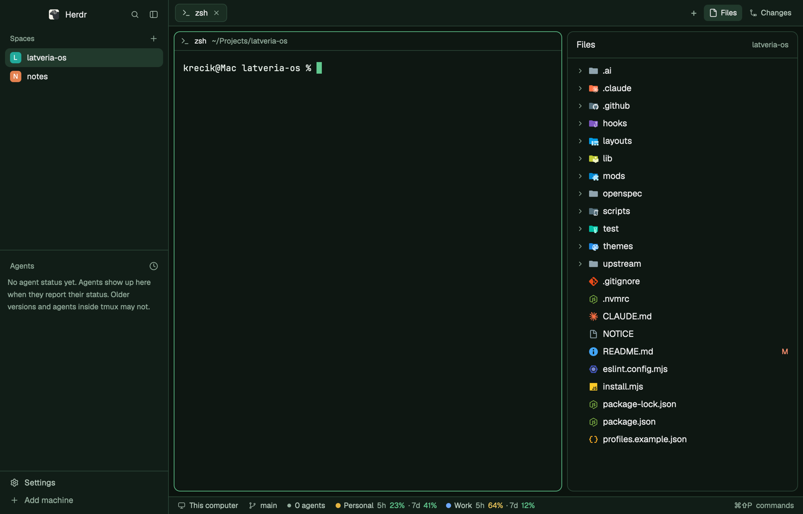

# LatveriaOS

A readable, dark-green Herdr layout for people who run Claude Code on several accounts and machines. Every agent in
the sidebar says which Claude profile it runs under and on which machine, the Files panel has full-color file-type
icons, and the status bar shows the 5-hour and 7-day usage limits of every profile, from every machine. Every
text/background pair is at least 4.5:1 and no text is smaller than 12 px.

## What you see

- **Theme `latveria`** (palette "Sosna"): background `#0e1712`, sidebar and bars `#111d17` (`chrome`), selected row
  `#21392c`, text `#e8f0ea`, secondary `#b9cbbf`, dim `#94ad9d`, accent and working `#62c98f`, blocked `#ff9070`,
  done `#7fb6ff`.
- **Left sidebar, 268 px**, on `chrome`: the brand row (46 px), Herdr's spaces list, then the **Agents list**, then the
  settings footer (69 px). Each agent row is 46 px and two lines: the agent's name (14 px) with its status and time,
  and below it (12 px) an 8 px dot in the profile's color, the profile's label, `· Mac` or the remote machine's name,
  and the tab's detail. An agent without a profile shows `?` and a ringed dot.
- **Work area**: Herdr's tabs bar (42 px), the terminal panes as cards (radius 10, 1 px border, accent border when
  focused), and a 368 px right panel with **Files** (and Herdr's Changes).
- **Files panel**: 28 px rows, a 16 px full-color Material Icon Theme icon per row (picked like VS Code: full name,
  then the longest extension, then the extension; open and closed folder icons), names 14 px, git marks on the right.
- **Status bar, 28 px**: this computer or the space's machine, the branch, the agent count and "needs you", then one
  segment per Claude profile: `● Personal 5h 23% · 7d 41%`. Percentages are green below 50 %, yellow (`#e8c35a`)
  below 80 %, red from 80 %. Without any snapshot it reads `limits ?`.
- **Dock icon**: the number of agents that need you as a badge, none when nobody waits.

## How it behaves

- **Agent status**: working, blocked, done and idle use the theme's status colors; blocked agents sort to the top as
  in Herdr. The selected row gets no status tint, so its badge keeps its contrast.
- **Hover**: on the narrow rail an agent's profile and machine are a tooltip. A limits segment's tooltip says on which
  machine the numbers are from, when each window resets ("resets in 4h 47m", "reset", or "no usage in the current
  window") and when the numbers last changed.
- **Remote machines**: profile maps and usage snapshots are read on each ready machine through its own shell. A
  machine that stops answering keeps its last numbers, dimmed, with their age (`· 2h ago`); one removed from Herdr
  takes them with it. A profile on two machines shows, per window, the reading with the later reset.
- **Waiting agents**: clicking `N needs you` shows the agent that has waited longest. While Herdr's window is not in
  front, each note Herdr posts (needs you, finished, …) becomes a macOS banner; clicking it brings Herdr forward on
  that agent, dismissing it does nothing. In front, notes are drawn in the window as Herdr draws them.
- **Hand-off**: hovering a local agent that isn't working shows a button (two-arrows icon) beside the pin when the
  terminal has the conversation labels and the map has another profile. It opens a popup of the other profiles with
  their 5h/7d limits; choosing one opens a tab `→ <label>` in the conversation's start folder that copies the
  conversation to that profile and resumes it there as a fork. The narrow rail shows no button.
- **Refresh**: the Agents list and the status bar re-read every 30 s; the status bar also reads a machine at once when
  it becomes ready. The Files panel watches folders locally and refreshes remote ones every 10 s.

## Built from

- `layouts/latveria.json`: a row of the sidebar column (`workspace-chrome`, `spaces`, `latveria-agents`,
  `workspace-chrome` with `footer: true`) and the work column (`tabs`, the active tab with `pane` headers, a
  `panel-body` stack of `latveria-files` and `changes`, and `latveria-status`). Theme `latveria`, root
  `"toast": "latveria-toast"`.
- `mods/latveria-agents`, `mods/latveria-files`, `mods/latveria-status`, `mods/latveria-toast`: clones of Herdr
  0.1.16's `agents`, `files`, `workspace-status` and `toast` (`cloned_from` in each `mod.json`). They use `agents`,
  `terminals` (labels), `machines`, `spaces`, `theme`, `exec`, `readTextFile`, `watchFolder`, `openOverlay`, `run`,
  `keys`, `setBadge`, `notify`, `shared`/`setShared`, `window().active`, `checking`.
- Programs they run: `sh` (to read `~/.config/latveria/profiles.json` and `~/.cache/latveria/quota-*.json` on each
  machine, capped at 64 KiB and 32 × 4 KiB), read-only `git` (`rev-parse`, `status`) in the Files panel, and
  `terminal-notifier` (optional, this computer only) for banners: `-title -message -group -activate dev.herdr.app
  -action Show -timeout 540`, text as arguments without control characters. No network, no credentials.
- Hand-off: `mods/latveria-agents/handoff.js` (pure functions and `HANDOFF_SH`, a fixed `sh` script that gets the
  transcript, target folder, uuid and target `claudeDir` only as `$1`–`$4`); the popup is an `openOverlay` popup of
  `latveria-agents`, the tab comes from `run("tab.new", {space, folder, name, argv})`.
- Outside Herdr, per machine: `hooks/latveria-label.sh`, a Claude Code `SessionStart` hook that labels the terminal
  `latveria.profile=<KEY>` and, from its stdin JSON, `latveria.transcript` and `latveria.cwd`; `hooks/latveria-quota.sh`, called from the statusline script with Claude Code's
  statusline JSON, which writes `~/.cache/latveria/quota-<KEY>.json` only when the limits change;
  `hooks/latveria-profile.sh`, the profile matching both share. They need `jq` and print nothing.
- Art: Material Icon Theme 5.40.0 SVGs (MIT), 1131 icons, in `mods/latveria-files/icons/material/`.

## Watch out

- **Copy the theme too**: the layout uses `themes/latveria.json`, which a layout install that copies only `layouts/`
  and `mods/` leaves out. `node install.mjs` copies themes, layouts, mods and hooks, with backups.
- **Profiles need the hook and a map**: without `~/.config/latveria/profiles.json` and the `SessionStart` entry every
  agent shows `?`; sessions started before the hook show `?` until they restart. Each machine has its own map.
- **Limits need one line in your statusline script** (see README). Claude Code leaves a window out of its statusline
  JSON while it has no usage; the bar shows that as 0 %.
- A terminal Herdr starts without a shell has no `~/.local/bin` on `PATH`; the hook falls back to `~/.local/bin/hc`.
- Herdr updates itself; after an update run `node scripts/upstream-diff.mjs` to see whether a cloned mod changed
  upstream.
- **Banners need `terminal-notifier`** (`brew install terminal-notifier`) and its permission in System Settings ›
  Notifications; without them notes stay in the window. Only its waiting mode (`-action … -timeout`) delivers the
  click; read `@TIMEOUT` in stdout, not the exit code, to tell an ignored banner from a click. A toast overlay's
  pending work ends when it closes, so the long-lived status bar waits for the click, not the toast.
- **Hand-off traps**: `claude --resume` looks only in its own `CLAUDE_CONFIG_DIR`, so the transcript must be copied
  into the target's `projects/<same folder>/`, which may not exist yet. Resume with `--fork-session`, or a hand-back
  overwrites a file the old session still writes to. For the default profile unset `CLAUDE_CONFIG_DIR`; setting it to
  `~/.claude` creates a stray `~/.claude/.claude.json`. Take the folder from the `latveria.cwd` label, not the pane's
  live folder: resume finds a conversation by the folder it started in.
- Text sizes live in the mods, so Herdr's own spaces list and tabs keep Herdr's sizes.

## Done when

- `herdr-app check` passes for `latveria-agents`, `latveria-files` and `latveria-status`, and `herdr-app status` shows
  no errors after `layout.switch {"name":"latveria"}`.
- A new Claude Code session in a Herdr terminal shows its profile's dot, label and `· Mac` in the Agents list.
- After a message in that session, `~/.cache/latveria/quota-<KEY>.json` exists and the status bar shows the profile's
  5h and 7d percentages within 30 s.
- The Files panel shows a different icon for `.md`, `.json`, `package.json`, `.ts` and an open folder.
- With `terminal-notifier` allowed and Herdr in the background, an agent asking for permission shows a banner;
  clicking it shows that agent in Herdr, and the Dock badge counts the agents that need you.
- `npm test` passes (contrast of every theme pair ≥ 4.5:1, no text below 12 px).
